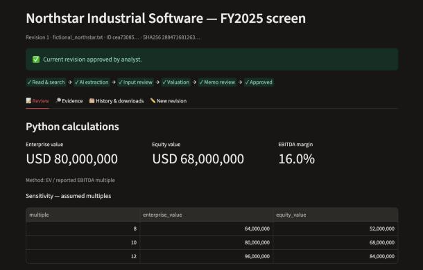
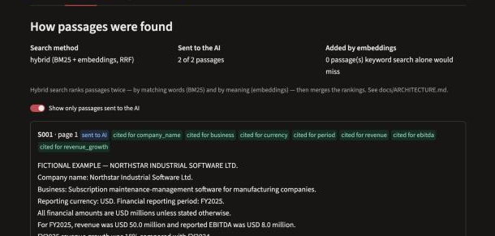
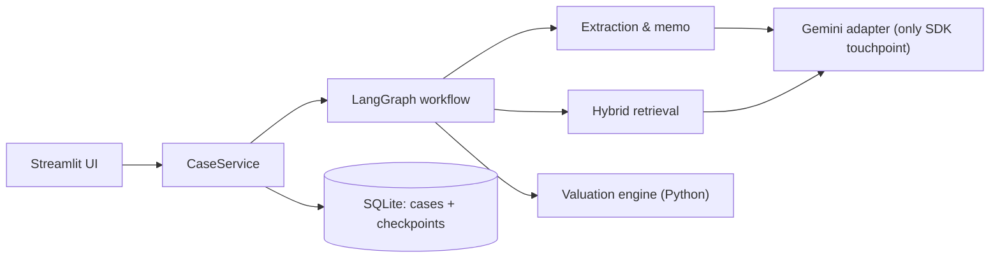

# DiligenceDesk

**AI-assisted investment screening where every number is cited, every
calculation is deterministic, and nothing is final without human sign-off.**

DiligenceDesk reads a company or infrastructure-asset document, extracts the
key financial facts with verbatim citations, has an analyst confirm them,
values the business in Python (EV/EBITDA or a full DCF), and drafts a
referenced screening memo for approval.



```
Upload ─▶ Hybrid search (RAG) ─▶ LLM extracts cited facts ─▶ ⏸ Analyst review
       ─▶ Python valuation (EV/EBITDA · DCF) ─▶ LLM memo ─▶ ⏸ Analyst approval
```

**Stack:** Python · LangGraph (human-in-the-loop interrupts, SQLite
checkpoints) · Gemini structured output and embeddings · BM25 + embedding
hybrid retrieval · Pydantic · Streamlit · Tesseract OCR

---

## Why it exists

Language models read financial documents quickly but are unreliable at the two
things an investment screen cannot get wrong: **where a number came from** and
**the arithmetic done with it**. DiligenceDesk splits the work so that each
part is done by whatever is trustworthy for it:

| Task | Done by | Safeguard |
|---|---|---|
| Find relevant passages | Hybrid search (BM25 + embeddings, RRF) | Visible fallback if embeddings fail |
| Read and extract facts | Gemini, as schema-validated JSON | Each fact needs a verbatim quote that Python verifies exists in the cited passage |
| Confirm facts and assumptions | **Analyst** (checkpoint 1) | Edits are diffed into an audit trail |
| Valuation maths | **Python only** | 130 offline tests, including independent arithmetic checks |
| Write the memo | Gemini | Every point must cite an allowed passage, calculation or assumption |
| Approve | **Analyst** (checkpoint 2) | Approval is bound to a SHA-256 fingerprint of the exact content |



## Results

Evaluated on **20 synthetic infrastructure annual reviews** (solar, toll roads,
water, ports, data centres…) with hard cases: figures in thousands, net cash,
adjusted-EBITDA-only reports and decoy figures. Full method and raw results are in
[docs/EVALUATION.md](docs/EVALUATION.md).

| | Paste whole document into LLM | DiligenceDesk pipeline |
|---|---|---|
| Facts correct (incl. correctly "missing") | 162 / 162 | 153 / 153 |
| Citations correct | 154 / 154 | 145 / 145 |
| **Wrong valuations produced** | **0** | **0** |
| Unsupported valuations correctly blocked | 2 / 2 | 2 / 2 |

What the evaluation showed:
- **It caught a real bug.** The validator rejected correct net-debt period-end
  dates, blocking 25 of 35 valid valuations. Fixed and covered by tests.
- **Retrieval doesn't add accuracy on short, clean documents.** Both
  approaches were perfect. The pipeline's value is auditable citations,
  documents too long to paste, and cost at scale.
- **Timeouts:** 5 of 40 calls failed at a 60 s limit, so it was raised to 120 s.
  Failures surfaced as visible errors and never as invented values.
- On a 13-page synonym-heavy document, hybrid search raised **MRR from 0.48 to
  0.62** over keyword search alone, and still misses one fact, which is documented.

## Features

- **Hybrid RAG:** BM25 + Gemini embeddings fused with Reciprocal Rank Fusion;
  an Evidence tab shows which passages were sent to the model and which facts cite them.
- **Cited, schema-validated extraction:** missing is never treated as zero,
  conflicts are flagged rather than resolved, and adjusted EBITDA is never taken as reported.
- **Two human checkpoints** via LangGraph `interrupt()`, with answers validated
  *before* resuming the graph, and stale browser tabs rejected.
- **Valuation:** EV/EBITDA with sensitivity and stress cases; a 3–10 year FCFF DCF
  with loss pools, working-capital days, a PP&E cohort roll-forward, a WACC × g
  grid and an optional linked three-statement forecast with funding-gap
  detection. See [docs/METHODOLOGY.md](docs/METHODOLOGY.md).
- **Historical ledger:** multi-year IS / BS / CF extraction with line-level
  review, conflicts and reconciliation diagnostics.
- **OCR** for scanned PDFs, keeping page images and confidence scores.
- **Durable cases:** survive restarts, immutable document revisions, version
  diffs, approvals that go stale when content changes, and a full audit trail.

## Architecture



Domain logic has no UI, database or model-SDK imports. The model client is
injected, so the full workflow runs in tests against fakes. Details and
diagrams of every step: [docs/ARCHITECTURE.md](docs/ARCHITECTURE.md).

### Design decisions

- **Deterministic maths, probabilistic reading.** The model never calculates;
  memo claims must reference `CALC:` outputs.
- **Validate before resuming.** LangGraph caches interrupt answers, so invalid
  analyst input is rejected *before* `Command(resume=…)`; otherwise a corrected
  resubmission could replay the bad answer.
- **No vector database.** Documents are capped at 30 pages (~100 passages), so
  in-memory cosine search takes milliseconds. Persistent vector storage would
  only pay off at a much larger scale.
- **Revisions, not edits.** Any change creates a new revision that needs fresh
  approval; old approvals stay attached to what they approved.

## Quick start

Tested with Python 3.13. OCR also needs Tesseract (`brew install tesseract`).

```bash
python -m venv .venv && .venv/bin/pip install -r requirements.txt
```

```bash
cp .env.example .env    # then add your GEMINI_API_KEY
```

```bash
.venv/bin/python -m streamlit run app.py
```

Run the test suite (offline, no API key needed, about 10 s):

```bash
.venv/bin/python app.py --check
```

Reproduce the evaluations:

```bash
.venv/bin/python evaluation/benchmark_retrieval.py --live
```

```bash
.venv/bin/python evaluation/run_eval.py --live
```

### Configuration (`.env`)

| Setting | Default | Purpose |
|---|---|---|
| `GEMINI_API_KEY` | none | Required for live screening |
| `GEMINI_MODEL` | `gemini-3.8-flash` | Extraction and memo model |
| `RETRIEVAL_MODE` | `hybrid` | `bm25` disables embedding calls |
| `GEMINI_EMBEDDING_MODEL` | `gemini-embedding-001` | Embedding model |
| `DEAL_SCREENING_DATA_DIR` | `./data` | Where saved cases are stored |

## Project structure

```
├── app.py                  Streamlit entry point and dependency wiring
├── deal_screening/
│   ├── workflow.py         LangGraph nodes, edges and human-review interrupts
│   ├── cases.py            case lifecycle: create, resume, revise, stale-tab checks
│   ├── storage.py          SQLite case store, immutable revisions, file locks
│   ├── documents.py        PDF/text ingestion, chunking, BM25
│   ├── retrieval.py        hybrid retrieval (BM25 + embeddings + RRF)
│   ├── ai.py               extraction and memo prompts, reference checks
│   ├── llm.py              Gemini adapter (the only SDK code)
│   ├── validation.py       evidence, unit and period validation
│   ├── finance.py, dcf.py  valuation engines
│   ├── ledger*.py          historical statement ledger
│   ├── approvals.py        content-bound approval fingerprints
│   └── case_page.py, forms.py, interface.py   UI
├── tests/                  130 offline tests (fake model, temporary storage)
├── evaluation/             benchmarks, 20-document evaluation, answer keys, results
├── sample_documents/       fictional test documents
└── docs/                   architecture, methodology, evaluation
```

## Limitations

- Quote verification proves a quote *exists* in the cited passage, not that it
  supports the claim; analyst review is required by design.
- Evaluated on synthetic documents and one model; real filings with complex
  tables and footnotes are harder.
- Documents are limited to 30 pages / 10 MB; OCR is English-only and limited to 10 pages.
- Local single-user storage; reviewer names are self-entered, not authenticated.
- Simplified tax, financing and accounting conventions (see the methodology).

---

*All sample companies and figures are fictional. This is a portfolio project,
not investment advice, and its outputs are not audited or GAAP/IFRS-compliant statements.*
