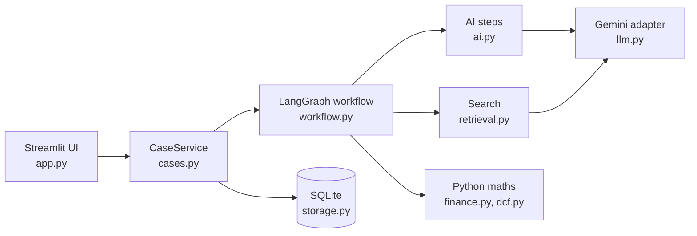
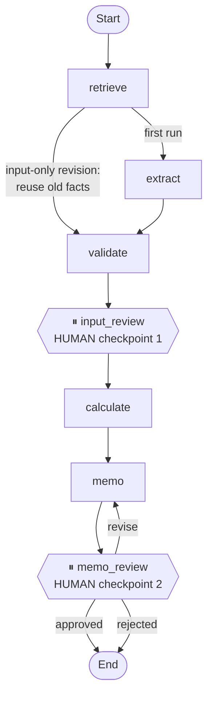
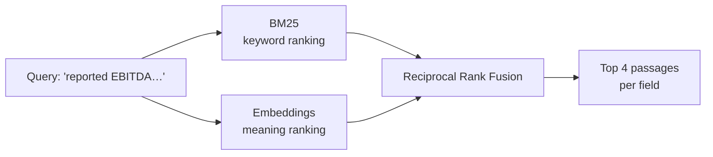
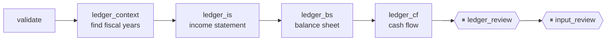
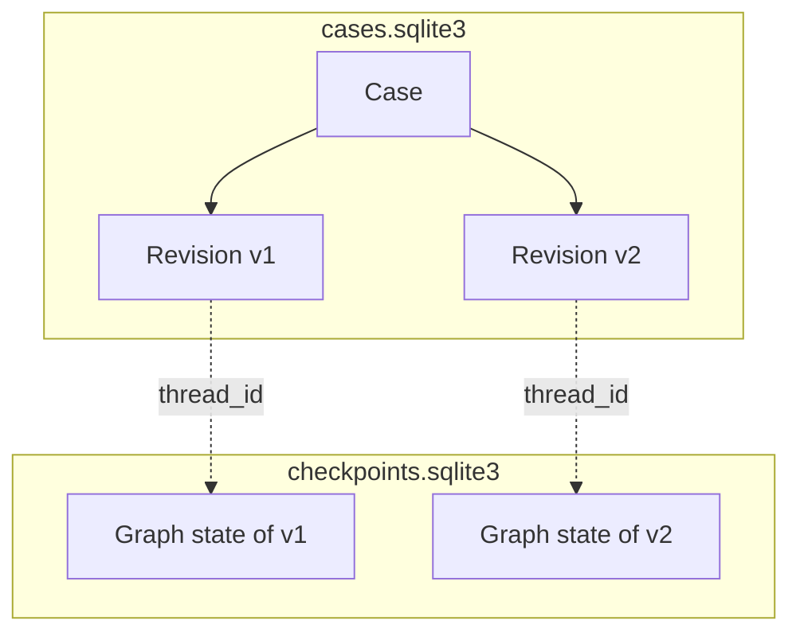

# DiligenceDesk architecture

This document follows one document from upload to an approved memo. Each
section names the module responsible, under `deal_screening/`.

**The big idea:** the AI does the reading and the writing. Python does all the
maths. A human checks the work at two fixed checkpoints, and nothing is
approved without them.

```
Document → find relevant passages → AI extracts facts → HUMAN checks facts
        → Python calculates the valuation → AI drafts a memo → HUMAN approves
```

---

## 1. The big picture



| Layer | Job | Knows about Gemini? | Knows about Streamlit? |
|---|---|---|---|
| `app.py` | Sidebar and wiring: picks which case to show | No (only wires it up) | Yes |
| `case_page.py`, `forms.py` | Case page (progress tracker, tabs) and the review forms | No | Yes |
| `cases.py` | Saves cases, starts and resumes the graph, blocks stale tabs | No | No |
| `workflow.py` | The order of steps and where to pause for a human | No | No |
| `retrieval.py`, `documents.py` | Read files, cut them into passages, search | No (embedder is passed in) | No |
| `ai.py` | Prompts for extracting facts and writing the memo | No (client is passed in) | No |
| `finance.py`, `dcf.py`, … | All valuation arithmetic | No | No |
| `llm.py` | The **only** file that talks to Google's SDK | Yes | No |

**Why split it this way?** Each part can be tested and swapped on its own. The
tests replace Gemini with fake objects, so all 130 tests run offline for free
in about 10 seconds. Switching to another AI provider would mean changing only
`llm.py`.

---

## 2. Step by step: the core screening path



Each box is a **node**: a Python method on `ScreeningWorkflow` in
[workflow.py](../deal_screening/workflow.py). A node receives the current
**state** (a dictionary, defined as `DealState` in
[models.py](../deal_screening/models.py)) and returns only the keys it changed.
LangGraph merges those changes into the state and moves to the next node.

### ① Read the document — `documents.py`
`DocumentReader.read()` pulls the text out of a PDF or `.txt` file, page by page.
If a PDF page has almost no text but contains an image (a scan), it runs
**OCR** with Tesseract (`ocr.py`) and keeps the confidence score. There are
limits: 10 MB, 30 pages and 100,000 characters.
`DocumentReader.chunks()` cuts each page into overlapping passages of about
1,100 characters, each with an ID like `S004` and its page number. Those IDs
are how every fact is traced back to the source later.

### ② `retrieve` — find the relevant passages (RAG) — `retrieval.py`
The AI never sees the whole document, only the passages most likely to contain
each of the nine facts (company name, revenue, EBITDA, net debt, …). Each fact
has a search query, listed in `FIELDS` in `models.py`.



- **BM25** scores passages by matching words. It's good for exact terms.
- **Embeddings** (Gemini `gemini-embedding-001`) turn each passage and query
  into a vector, a list of numbers that captures meaning. Passages that *mean*
  the same thing score high (cosine similarity) even with different words,
  such as "turnover" and "revenue".
- **RRF** merges the two rankings: each passage gets `1/(60 + rank)` from every
  ranking it appears in. Only ranks are used, so the two very different score
  scales never need to be compared directly. A passage only gets a vote if it
  actually matched; otherwise BM25's "ranking" would just be document order.
- **Fallback:** if the embedding call fails, the search uses BM25 alone and
  writes `"embedding fallback"` plus the error into the audit trail. Set
  `RETRIEVAL_MODE=bm25` in `.env` to switch embeddings off.
- Passage vectors are cached by a hash of their text, so the historical ledger's
  three searches don't re-embed the same document.

### ③ `extract` — the AI reads the passages — `ai.py`
`FactExtractor` sends the passages to Gemini with strict rules: missing means
`null`, never zero; conflicts are flagged, not resolved; every found fact needs
a **verbatim quote** and the passage ID it came from. Gemini must answer in
JSON that matches a Pydantic model (`Extraction`), so the response is
**structured output**, not free text. If the call fails, every fact is marked
missing and the error is shown. No fake values are ever substituted.

### ④ `validate` — Python checks the AI — `validation.py`
Does each quoted sentence really exist in the passage it cites? Do currencies
and periods match? Are numbers valid? Problems are listed for the human. Note
that this proves a quote *exists*, not that it *means* what the AI claims.
That's what the human check is for.

### ⑤ `input_review` — ⏸ Human checkpoint 1
The node calls LangGraph's `interrupt()`. The graph **stops and saves itself**.
The UI shows the facts with their quotes in an editable table, plus a form for
valuation assumptions (multiple, or DCF growth, margins, WACC and so on). The
analyst corrects anything, ticks "I checked…", enters their name and a note,
then submits. The answer goes back into the graph with `Command(resume=answer)`.

### ⑥ `calculate` — pure Python maths — `finance.py`, `dcf.py`
- **EV/EBITDA:** enterprise value = EBITDA × the analyst's multiple, and
  equity = EV − net debt.
- **DCF:** forecast revenue, costs, tax, capex and working capital; discount
  free cash flow at WACC; add a terminal value; run downside and sensitivity cases.
- Optional extras: `operating_forecast.py`, `fixed_assets.py` and `three_statements.py`.

**The AI never does arithmetic.** Language models make maths mistakes, while
Python doesn't, and Python's results can be tested.

### ⑦ `memo` — the AI writes up — `ai.py`
`MemoWriter` gets the confirmed facts, assumptions and Python results, and
writes 3–6 observations and 3–5 diligence questions. Every observation must
cite references from an allowed list: `S004` for a passage, `CALC:equity_value`
for a calculation, `ASSUMPTION:multiple` for an assumption. Unknown references
are rejected.

### ⑧ `memo_review` — ⏸ Human checkpoint 2
The analyst chooses **approve**, **revise** (the feedback goes to the AI and the
graph loops back to `memo`) or **reject**. On approval, `approvals.py` stores a
**fingerprint**: a SHA-256 hash of the exact evidence, assumptions,
calculations and memo that were approved.

---

## 3. Optional path: the historical ledger

When "Extract a multi-year historical statement ledger" is ticked, the graph
takes a detour after `validate`:



That's four AI calls, one per stage, each saved as it finishes. The analyst
reviews every line (with exclusions and conflicts explained), picks a year, and
the headline facts are built from the confirmed ledger (`ledger.py`,
`LedgerBridge`), so no separate nine-fact extraction is needed.

---

## 4. Saving, resuming and revisions — `cases.py`, `storage.py`



- **Two databases.** `cases.sqlite3` holds the case, each revision's original
  file bytes (never edited) and an event log. `checkpoints.sqlite3` is
  LangGraph's `SqliteSaver`, holding the graph state after every node.
- **Thread ID = revision ID.** Each revision is its own graph run. Because the
  state is saved after each node, you can close the app at a checkpoint,
  restart and continue where you left off.
- **Revisions never overwrite.** Changing inputs, replacing the document or
  re-extracting creates **v2**, which needs fresh reviews. v1 and its approval
  stay as history, and an old approval can never approve the new revision.
- **Stale tabs.** Every form carries the checkpoint ID it was shown with. If
  another tab moved the case on, `_require_fresh()` refuses the submission.
  File locks stop two tabs writing at once.

### Why answers are checked *before* resuming (an important bug fix)
LangGraph remembers the answer you give to an `interrupt()`. If a node
validated the answer only *after* resuming and raised an error, that bad answer
stayed cached, and the *corrected* answer could be ignored on the next try. So
`CaseService.resume()` runs the same checks first (`prepare_input_review`,
`prepare_memo_review`, `prepare_review`) and only calls `Command(resume=…)`
once the answer is valid. The nodes repeat the checks as a safety net.

---

## 5. The audit trail

Every node appends to `state["audit"]` (`audit.py`): which search method ran,
whether extraction succeeded, which facts the analyst changed (old → new), the
reviewer names and notes, and the decision. The downloadable report
(`reporting.py`) includes all of it, along with the limitations.

---

## 6. Rules the code never breaks

1. Missing is never treated as zero.
2. Quotes must exist in the cited passage.
3. Failures are shown, never hidden behind fake data.
4. The AI never does the maths.
5. Approval is tied to the exact content approved, so any change needs a new approval.
6. Documents are *data*, never instructions. Text inside an uploaded PDF can't
   command the AI (see the system instruction in `llm.py`).

---

## 7. Suggested reading order for the code

1. `models.py`: what the state and the AI's answers look like.
2. `workflow.py` → `build()`: the whole graph in about 30 lines.
3. `retrieval.py`: RAG in about 120 commented lines.
4. `ai.py`: the prompts.
5. `cases.py` → `resume()`: how a human answer re-enters the graph.
6. `tests/test_retrieval.py`: see how fakes replace Gemini.

Run the test suite from the repository root:

```bash
.venv/bin/python app.py --check
```
